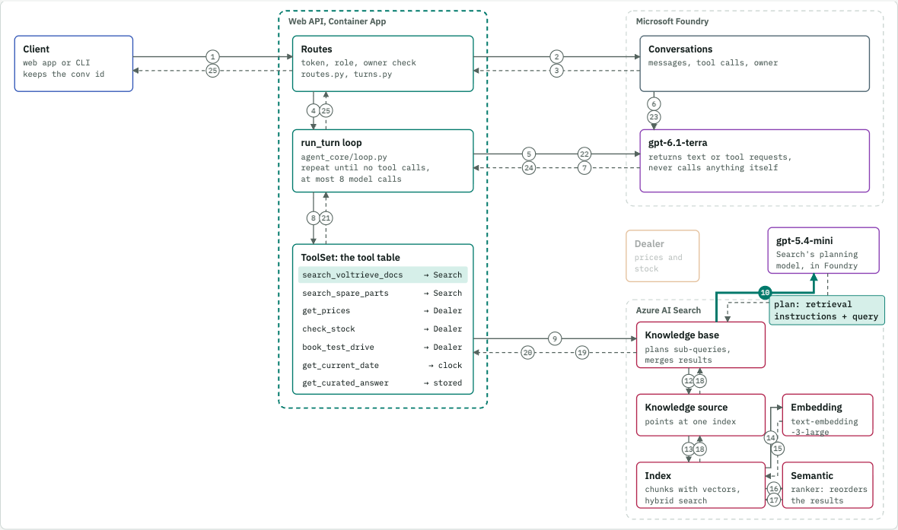
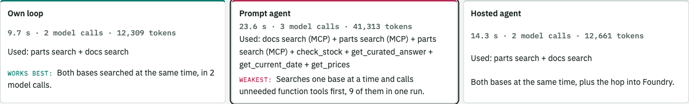
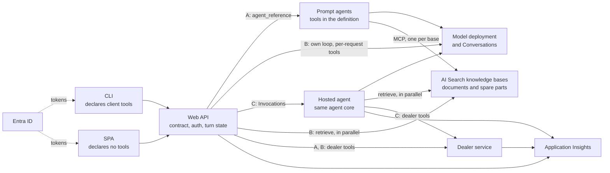

# Agentic RAG on Azure, three ways, with the receipts

**The same assistant built as an own loop, a Foundry prompt agent and a Foundry hosted agent, deployed side by side and measured with real runs.** See exactly who calls what, where each design wins, and where it fails.

[](https://mklab-se.github.io/agentic-rag/assets/prompt-journey.html)

Most agent samples stop at "it answers". This one answers the questions you meet in the next meeting:

| The question | The short answer | Read more |
| --- | --- | --- |
| **Why host an agent in Foundry at all?** | For a managed identity, versions and a publishing path. Not for the loop, which is 252 lines of Python. | [Comparison](docs/why-foundry.md) |
| **My client has its own tools. Now what?** | A prompt agent refuses per-request tools with a 400. An own loop or a hosted agent runs them, even one the server has never seen. | [Client tools](docs/why-foundry.md#1-what-happened-with-client-tools) |
| **How does the agent decide to use RAG?** | No classifier exists. The model decides in its first call, from words you control. | [The journey of a prompt](docs/prompt-journey.md) |
| **Can it use several knowledge bases without calling them in vain?** | Yes: all three reached the right bases in every run. Two of them run the searches at the same time. | [Two knowledge bases](docs/why-foundry.md#6-two-knowledge-bases-who-chooses-and-who-runs-them-together) |
| **I need curated answers without slowing everything down.** | Pick the answer in the model call you already make, then skip the second one. Curated questions took under 2 s on two of the three, and other questions showed no measurable delay. | [Curated answers](docs/prompt-journey.md#curated-answers) |

## See it: the journey of a prompt

**[Open the interactive journey](https://mklab-se.github.io/agentic-rag/assets/prompt-journey.html)**, or browse [the documentation site](https://mklab-se.github.io/agentic-rag/). Pick an architecture and a prompt, then step through every call: who makes it, what it carries and what comes back.

- **Three architectures on one map.** The boxes stay in place and you can watch what moves.
- **Seven real prompts,** from a greeting to a two-base spare parts job and a client-side tool.
- **Detailed RAG.** Follow one question from the agent through the knowledge base, knowledge source, index, embedding model and semantic ranker.

Prefer text? [docs/prompt-journey.md](docs/prompt-journey.md) has the same story as Mermaid diagrams.

## Three architectures compared



| What you care about | Own loop | Prompt agent | Hosted agent |
| --- | --- | --- | --- |
| Everyday question | **1.6 s** | **2.0 s** | 6.0 s, about 4 s slower on every turn |
| Question for two knowledge bases | **12.3 s**, searches run together | 16.5 s, one at a time | 17.2 s, searches run together |
| A client tool the server has never seen | **Works** | Refused | **Works** |
| Curated answer, word for word | **1.7 s** | **1.8 s** | 6.4 s |
| Control over each search | **Full** | Little, it runs inside Foundry's agent run | **Full** |
| Code you own for searching | A client per base | **None, declare an MCP tool** | A client per base |
| Agent identity and versions in Foundry | No | **Yes** | **Yes** |
| Change instructions without shipping code | No | **Yes** | No |

**Which one should you pick?** The own loop when clients bring tools or speed matters. The prompt agent when the tool list is fixed and you want the least code. The hosted agent when you also need an agent identity or a publishing path. Medians come from live runs, and the [evidence](docs/evidence/) is in the repository.

The diagram below is the whole system. The only thing that changes between backends is who makes the calls.



Choose per request with `X-Agent-Backend: prompt|loop|hosted`. Clients can't otherwise tell which one answered, so you can compare them on real traffic.

## What you can reuse

- **A shared agent loop** ([`agent_core/`](agent_core/)): parallel tool calls, roles on tools, schema checks, pause and resume for client tools.
- **Client tools end to end**: a turn that pauses, runs on the user's machine and picks up again, with repair when a client disappears.
- **Curated answers** ([`curated.py`](agent_core/src/voltrieve_agent/curated.py)): approved text, word for word, with no search on every turn.
- **Agentic retrieval as code** ([`search/definitions/`](search/definitions/)): knowledge bases, sources, indexes and skillsets, on the latest API version.
- **Keyless Azure**: Entra and managed identities everywhere, deployed with one `azd up`.
- **Routing tests** ([`tests/routing/`](tests/routing/)): prove that the model picks the right source, and catch calls in vain.

## Quick start

The story is Voltrieve, a fictional electric car maker, so all data is generated and safe to share. You need `az`, `azd`, `uv`, Node.js and, on Apple Silicon without Rosetta, Docker. See [docs/deploy.md](docs/deploy.md) for rights, regions and hooks.

```sh
az login && azd auth login
azd env new voltrieve-dev
azd env set AZURE_LOCATION swedencentral
azd up                     # watch for the tester password, printed once
scripts/deploy-web.sh      # only where the SWA CLI cannot run
scripts/deploy-agents.sh
```

Then ask something, on any backend:

```sh
# The CLI reads API_URL, TENANT_ID, CLI_CLIENT_ID and API_CLIENT_ID from the azd environment.
uv run --project clients/cli voltrieve ask "Which Voltrieve charges fastest?" --backend loop --az-token
uv run --project clients/cli voltrieve chat --backend hosted --az-token
```

Check it with `uv run scripts/runbook.py` and `uv run tests/grounding/check.py`. Measure routing with `uv run tests/routing/check.py --repeats 1 --no-save`. The walkthrough is in [docs/runbook.md](docs/runbook.md).

Tear down with `azd down --purge`. App registrations and the tester are not removed by azd: [docs/deploy.md](docs/deploy.md#teardown) shows how to delete them.

## Repository layout

| Path | Contents |
| --- | --- |
| `agent_core/` | The shared loop, model client, tools, dealer and knowledge base clients |
| `api/` | The Web API and its three backends |
| `agents/prompt/` | Prompt agent definitions and the rejection demo (backend A) |
| `agents/hosted/` | Hosted agent container and deployment (backend C) |
| `clients/cli/` | The CLI client |
| `clients/web/` | The SPA client |
| `services/dealer/` | The dealer web service |
| `search/` | Definitions and tooling for the Search objects |
| `data/` | The source data file, document generator and generated documents |
| `infra/` | Bicep modules and the Entra setup script |
| `hooks/` | azd hooks |
| `scripts/` | Agent and web deployment, runbook, denied demo, line count |
| `tests/` | Contract tests and the grounding check |
| `docs/` | Comparison, journey of a prompt, runbook, deployment, decisions, evidence, design |

## Costs

Idle, about 80 USD a month plus a small amount for Log Analytics: Search Basic is about 75 USD and Container Registry Basic about 5 USD. Container Apps scale to zero, the Static Web App is on the Free tier, models bill per token, and the hosted agent bills per active session.

## Status

Deployed and run live on 2026-11-04 and 2026-11-05.

Verified live:

- All three backends through the deployed API: every runbook step passes on the final build, including the automated trace check in step 12.
- Grounding: 30 of 30 answers passed.
- The cross-document question "cheapest AWD in Sweden" repeated 6 times per backend: 18 of 18 right. At the default reasoning effort it was 11 to 15 of 18, so the sample uses medium effort.
- A tool the server has never seen (`set_emissivity`, declared only in the request): relayed on loop and hosted, refused on prompt (`docs/evidence/new-client-tool.txt`).
- Recovery on all three backends: a paused turn nobody answers, and a conversation resumed after the API scaled to zero (`docs/evidence/repair.txt`).
- One trace per turn across API, Foundry, hosted agent and dealer (`docs/evidence/application-insights.txt`).
- The prompt agent's 400.
- The authorization denied path, on the loop backend, against real Foundry with a fake token validator.

Offline tests pass: `agent_core` 68, `api` 118, `agents/hosted` 18, `tests/contract` 25, `clients/cli` 23, `services/dealer` 37, `search` 25, Entra setup 31, `clients/web` 28.

Not verified:

- Interactive sign-in to the SPA, and a real browser sign-in with `voltrieve login` (its MSAL calls are tested against a fake).
- A real sign-in as the tester.
- Publishing to Teams and Microsoft 365.
- Latency and cold-start figures.

## More

- [The journey of a prompt](docs/prompt-journey.md)
- [Why Foundry: the comparison](docs/why-foundry.md)
- [Demo runbook](docs/runbook.md)
- [Deployment](docs/deploy.md)
- [Decisions and live findings](docs/decisions.md)
- [Evidence](docs/evidence/)
- [Design](docs/superpowers/specs/2026-11-03-voltrieve-agentic-rag-design.md)
