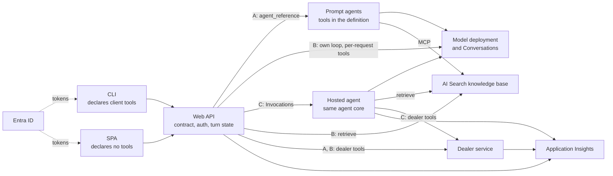

# Voltrieve: agentic RAG on Azure with client tools

A reference implementation of agentic RAG on Azure, built around a fictional electric car maker. It answers two questions with running code and visible logs. A Foundry prompt agent refuses per-request tools, so what do you do when the client has tools of its own? And why host an agent in Foundry at all?

It ships three backends behind one Web API, a CLI that declares its own tools, a web client that declares none, one knowledge base in Azure AI Search, and a sample dealer service.

## The two questions

**How do client-side tools coexist with a Foundry-based RAG solution?** A prompt agent rejects `tools` with `400 Not allowed when agent is specified.`, so client tools must be in its definition, which only suits a fixed list. Calling the Responses API with a model accepts per-request tools, so an own loop in a web API solves it directly. A hosted agent can run the same loop, but needs the Invocations protocol, because its Responses protocol drops caller tools.

**Why define and host an agent in Foundry at all?** For a managed agent identity, versions and a path to Teams and Microsoft 365. Not for the loop: it is 210 lines of Python, and most of the work (turn state, auth, tracing, relay) stays in your API with any backend. Use an own loop when clients bring tools, a hosted agent when you also need agent identity or publishing, and a prompt agent when the tool list is fixed.

The full argument, with evidence and line counts, is in [docs/why-foundry.md](docs/why-foundry.md).

## Architecture



Pick a backend per request with `X-Agent-Backend: prompt|loop|hosted`. The clients cannot otherwise tell which one answered.

## Quick start

You need `az`, `azd`, `uv`, Node.js and, on Apple Silicon without Rosetta, Docker. See [docs/deploy.md](docs/deploy.md) for rights, regions and hooks.

```sh
az login && azd auth login
azd env new voltrieve-dev
azd env set AZURE_LOCATION swedencentral
azd up                     # watch for the tester password, printed once
scripts/deploy-web.sh      # only where the SWA CLI cannot run
scripts/deploy-agents.sh
```

Then ask something:

```sh
# The CLI reads API_URL, TENANT_ID, CLI_CLIENT_ID and API_CLIENT_ID from the azd environment.
uv run --project clients/cli voltrieve ask "Which Voltrieve charges fastest?" --backend loop --az-token
uv run --project clients/cli voltrieve chat --backend hosted --az-token
```

Run the checks with `uv run scripts/runbook.py` and `uv run tests/grounding/check.py`. `scripts/deploy-agents.sh` ends with `scripts/smoke.py`: health of the API and dealer, the indexer, and one question per backend. The walkthrough is in [docs/runbook.md](docs/runbook.md).

Tear down with `azd down --purge`. App registrations and the tester are not removed by azd: [docs/deploy.md](docs/deploy.md#teardown) shows how to delete them.

## Repository layout

| Path | Contents |
| --- | --- |
| `agent_core/` | The shared loop, model client, tools, dealer and knowledge base clients |
| `api/` | The Web API and its three backends |
| `agents/prompt/` | Prompt agent definitions and the rejection demo (backend A) |
| `agents/hosted/` | Hosted agent container and deployment (backend C) |
| `clients/cli/` | The CLI client |
| `clients/web/` | The SPA client |
| `services/dealer/` | The dealer web service |
| `search/` | Definitions and tooling for the Search objects |
| `data/` | The source data file, document generator and generated documents |
| `infra/` | Bicep modules and the Entra setup script |
| `hooks/` | azd hooks |
| `scripts/` | Agent and web deployment, runbook, denied demo, line count |
| `tests/` | Contract tests and the grounding check |
| `docs/` | Comparison, runbook, deployment, decisions, evidence, design |

## Costs

Idle, about 80 USD a month plus a small amount for Log Analytics: Search Basic is about 75 USD and Container Registry Basic about 5 USD. Container Apps scale to zero, the Static Web App is on the Free tier, models bill per token, and the hosted agent bills per active session.

## Status

Deployed and run live on 2026-11-04.

Verified live:

- All three backends through the deployed API. The runbook passes on every step except the cross-document step 7, which is non-deterministic (below).
- Grounding on the final build: 30 of 30 answers passed.
- The cross-document question "cheapest AWD in Sweden" repeated 6 times per backend: 13 of 18 right (prompt 5, loop 4, hosted 4). The checks are not loosened for it.
- Recovery on all three backends: a paused turn nobody answers, and a conversation resumed after the API scaled to zero (`docs/evidence/repair.txt`).
- One trace per turn across API, Foundry, hosted agent and dealer (`docs/evidence/application-insights.txt`).
- The prompt agent's 400.
- The authorization denied path, on the loop backend, against real Foundry with a fake token validator.

Offline tests pass: `agent_core` 45, `api` 118, `agents/hosted` 18, `tests/contract` 20, `clients/cli` 23, `services/dealer` 37, `search` 25, Entra setup 31, `clients/web` 28.

Not verified:

- Interactive sign-in to the SPA, and a real browser sign-in with `voltrieve login` (its MSAL calls are tested against a fake).
- A real sign-in as the tester.
- Publishing to Teams and Microsoft 365.
- Latency and cold-start figures.

## More

- [Why Foundry: the comparison](docs/why-foundry.md)
- [Demo runbook](docs/runbook.md)
- [Deployment](docs/deploy.md)
- [Decisions and live findings](docs/decisions.md)
- [Evidence](docs/evidence/)
- [Design](docs/superpowers/specs/2026-11-03-voltrieve-agentic-rag-design.md)
