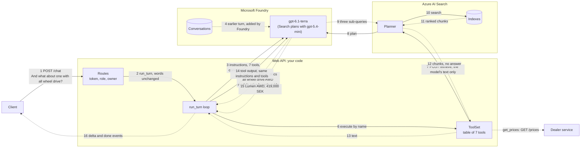
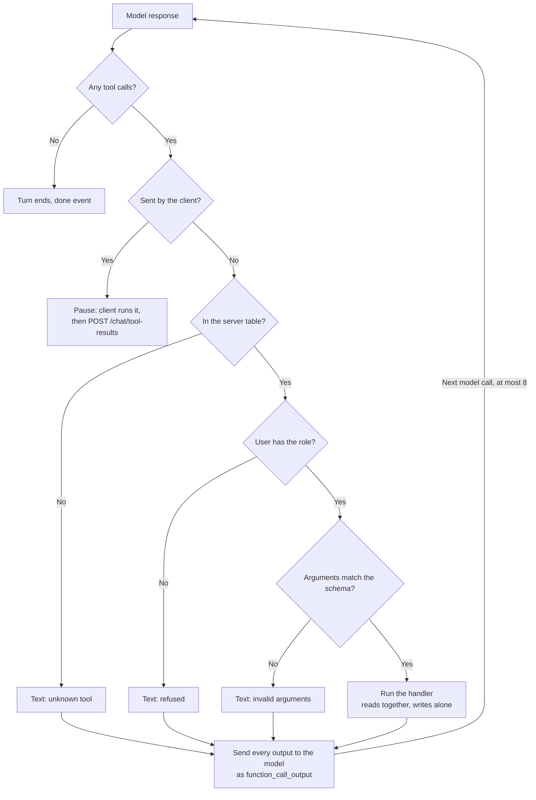
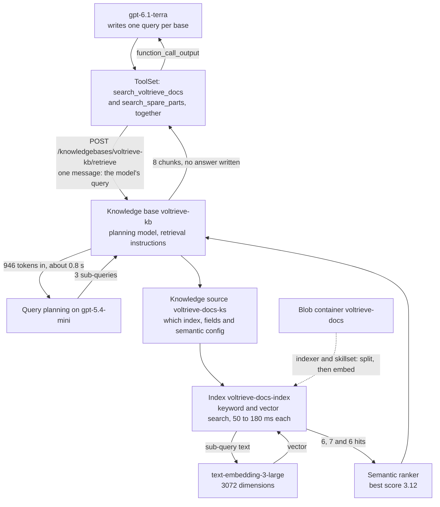
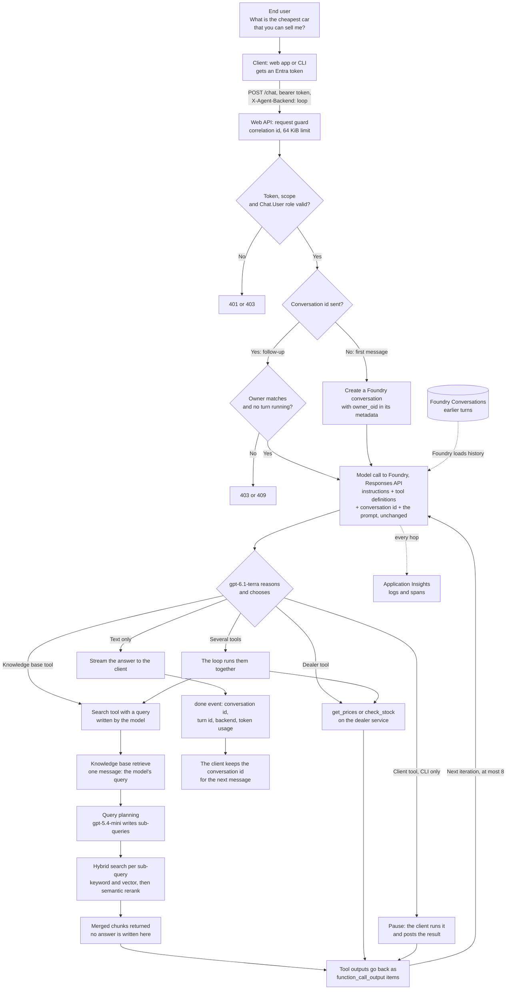
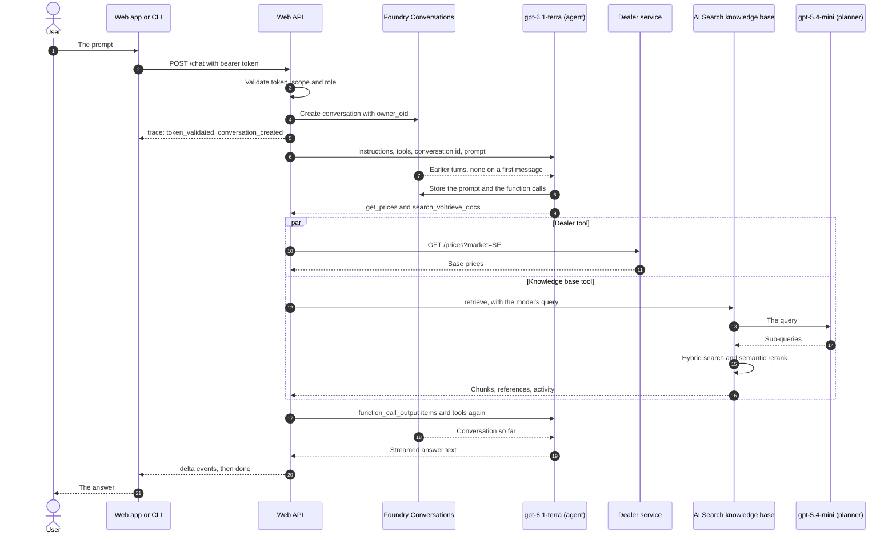

# The journey of a prompt through the own loop

This document follows one prompt through backend B, the own loop, on the deployed system:

> What is the cheapest car that you can sell me?

Numbers come from live runs on 2026-11-04 (`scripts/prompt_journey.py`, `docs/evidence/prompt-journey.txt`).

## The short version

- **Nothing classifies the prompt.** No code and no separate model decides whether it needs RAG. The chat model decides, while it reasons inside the first model call, by choosing to answer or to call tools.
- **Your exact prompt uses a tool and a knowledge base.** In 15 of 15 runs the model asked for the dealer price list and a search of the documents in the same response. On `gpt-5.4-mini` it never searched for this prompt, so the model choice changes the route.
- **The API sends the prompt to the model unchanged.** It never rewrites it, and it never loads history into the request.
- **History lives in Foundry.** The API sends a conversation id, and Foundry supplies the earlier turns to the model.
- **The user's words never go to Azure AI Search as they are.** The model writes a search query. Search then uses a second model call to turn that query into sub-queries.
- **Two chat models are at work.** All three backends run `gpt-6.1-terra`, and Search plans with `gpt-5.4-mini`, because it refuses GPT-6 models. An embedding model is also used, by Search.
- **The figures below were recorded with `gpt-6.1-terra`,** except where a section names another model. See [Choosing a model](model-comparison.md).

## Who calls whom

**The model never calls anything.** It only returns text, or a request to run a tool. In the own loop the Web API makes every real call, because the loop (`run_turn` in `agent_core/src/voltrieve_agent/loop.py`) runs inside the API process. The [visual page](assets/prompt-journey.html) lets you step through this arrow by arrow.

This is the real run of a follow-up question, `prompt-trace.txt` in [evidence](evidence/README.md). Solid arrows are calls and dotted arrows are what comes back:



For "What is the cheapest car that you can sell me?", the model also asks for `get_prices` in the same response, so `GET /prices?market=SE` runs alongside the search. The prices are live data in the dealer service, and `get_prices` is a thin function that fetches them. The model chooses it because of its description and the instructions, and the Web API runs it.

### What happens when the model names a tool

`build_server_tools()` creates seven `ServerTool` objects with a name, description, schema and Python handler. `ToolSet` keeps them in a dictionary keyed by name. Name, description and schema are sent to the model on every call. The handler never is. When a response names a tool, the loop does this:



### No RAG, simple RAG and agentic RAG

These aren't branches in the code. The only check is whether the response holds tool calls. The names describe what the model asked for:

| Name | Real example | What happened |
| --- | --- | --- |
| No RAG | Good morning! | 1 model call, no tool |
| Simple RAG | And what about one with all wheel drive? | Model, 1 search, model |
| Agentic RAG | The cheapest AWD car in Sweden | Model, 4 tools at once, model. It could also search again after reading |

Every Azure AI Search call uses agentic retrieval, so even "simple RAG" gets a query planner.

### What the model reads on each call

**Bold** is sent by the Web API. The rest is added by Foundry from the stored conversation.

| Call | Instructions and tools | Stored history | New input |
| --- | --- | --- | --- |
| Message 1, call 1 | **Sent** | None | **The prompt** |
| Message 1, call 2 | **Sent** | Prompt, `get_prices` call | **The price list** |
| Message 2, call 1 | **Sent** | Prompt, call, price list, answer | **The new prompt** |
| Message 2, call 2 | **Sent** | All of that, new prompt, search call | **The chunks** |

A first message creates the conversation and stores the owner. A later message checks the owner. Everything else is the same.

### Curated answers

Some questions need an approved answer, word for word: "What is the phone number to Voltrieve?", or "There is smoke coming from under my car!". `get_curated_answer(topic)` covers them on all three backends. The model picks a topic in its normal first call and never sees the text. The Web API sends the stored text from `agent_core/src/voltrieve_agent/curated.py`, adds it to the conversation and skips the second model call. On the prompt agent this works because function tools come back to the Web API.

Nothing runs in front of the model, so a normal question makes no extra call. When the same message also needs another tool, the text goes to the model as a normal tool output. The model then writes a complete answer, and it may reword the text.

A changed text needs a new API image, and on the hosted agent a new agent image too. A new topic also needs `scripts/deploy-agents.sh`, because prompt agents hold the topic list. Measured with 8 runs per question and backend, medians for normal questions moved by -0.7 to +0.2 s, within the normal spread, for 200 to 600 more tokens per turn. Curated questions took 1.5 to 1.9 s, and about 6 s on the hosted agent. The figures are in [evidence](evidence/curated-latency.txt).

### What the user sees while waiting

Long answers can take seconds to start, and silence makes a solution look broken. So the API sends a `status` event on the same stream, with a stable code and a default text:

```text
event: status
data: {"code": "searching_parts", "message": "Searching the parts catalog"}
```

The first one goes out before anything slow, so the user knows the request arrived. After that, each tool says what it's doing: searching, checking prices or waiting for the user's device. A search inside Foundry is named by its knowledge base, because the Web API sees it start. Rate limit retries say "Busy, trying again", because those are the longest silent waits. A status never holds the user's words or tool arguments, and clients that don't know the event ignore it. This makes the wait feel shorter but no faster, so TTFT stays the number to watch.

### The three backends

| Who does this? | Own loop | Prompt agent | Hosted agent |
| --- | --- | --- | --- |
| Checks token, role and owner | Web API | Web API | Web API |
| Creates the conversation | Web API | Web API | Web API |
| Holds instructions and tool list | Web API, sent on each call | Foundry, in the agent definition | Hosted container, sent on each call |
| Calls the model | Web API | Web API, sending only the agent's name | Hosted container |
| Calls Azure AI Search | Web API | Foundry, through MCP, during the agent run | Hosted container |
| Calls the dealer service | Web API | Web API | Hosted container |

The prompt agent still runs a loop in the Web API, because the dealer tools are function tools, and Foundry hands those requests back for the caller to run. Only the searches run inside Foundry. The hosted agent is the same `run_turn` code in a container that Foundry runs.

### Detailed RAG

The interactive page has a Detailed RAG tab. This is the same path as a diagram, for "I have a Voltrieve Fjord AWD. I want to completely change the brakes on the left front side. Which spare parts do I need?". The numbers come from recorded calls in [search-activity.txt](evidence/search-activity.txt).



The spare parts base runs the same path at the same time, through `voltrieve-parts-kb`, `voltrieve-parts-ks` and `voltrieve-parts-index`. On the prompt agent the same objects are used, but the first arrow into the knowledge base starts inside Foundry, through MCP, and the two bases run one after the other.

### Where each backend works better, and where it fails

| What you care about | Own loop | Prompt agent | Hosted agent |
| --- | --- | --- | --- |
| Everyday question | 1.5 s | 1.8 s | 6.5 s, the hop into the agent session adds about 5 s |
| Two knowledge bases | 7.8 s, together | 10.9 s, one at a time | 12.8 s, together |
| A client tool the server has never seen | Works | Refused | Works |
| Staying on task | No tool in vain | No tool in vain in 48 runs, after its own instructions fixed this | No tool in vain |
| Input tokens for a greeting | About 1,270 | About 2,680 | About 1,270 |
| Control over each search | Full | Little, it runs inside Foundry's agent run | Full |
| Code for searching | A client and a tool per base | None, an MCP tool per base | A client and a tool per base |
| Change instructions without shipping code | No | Yes, a new agent version | No |

The per-prompt figures on all three backends are in [journeys.json](evidence/journeys.json), and the interactive page embeds them.

## The whole path



## What actually happens to this prompt

Measured with `scripts/prompt_journey.py` on the own loop, 15 runs of each prompt on `gpt-6.1-terra`. The raw counts are in [prompt-journey.txt](evidence/prompt-journey.txt).

| Prompt | Runs | What the agent used | Result | Model calls | Median time |
| --- | --- | --- | --- | --- | --- |
| What is the cheapest car that you can sell me? | 15 | `get_prices` and 1 search | Spark, 289,000 SEK | 2 | 5.7 s |
| ... in Sweden? | 13 | `get_prices` and 1 search | Spark, 289,000 SEK | 2 | 5.6 s |
| | 2 | `get_prices` once | Spark, 289,000 SEK | 2 | 3.1 s |
| ... with all wheel drive ... in Sweden? | 15 | `get_prices` and 1 search | Lumen AWD, 419,000 SEK | 2 | 5.6 s |
| Good morning! | 15 | Nothing | A greeting | 1 | 1.3 s |

After the first question, the follow-up "And what about one with all wheel drive?" gave the Lumen AWD at 419,000 SEK in all 15 runs. 11 searched, and 4 answered from what the conversation already held.

The same words can take different paths, because the model chooses again on every run. The instructions say to use the price tool when the user asks about prices, and to use the documentation for anything about the vehicles, including what they cost. So `gpt-6.1-terra` usually does both. `gpt-5.4-mini` read the same instructions differently: for the first prompt it never searched, and in 3 of 15 runs it asked for the market instead.

`market` is optional in the tool definition, and the API sends `SE` when the model gives none.

## Step by step

This is the path of the AWD question, since it uses every part. Your prompt follows the same steps.



### 1. The client

The web app gets an access token with MSAL and sends the prompt with `fetch`. The CLI does the same with its own sign-in. The Static Web App only hosts the page, so the browser calls the Web API directly.

```json
POST /chat
Authorization: Bearer <token for api://.../access_as_user>
X-Agent-Backend: loop
X-Correlation-Id: <uuid>

{ "message": "What is the cheapest car that you can sell me?" }
```

There is no `conversation_id` on a first message. The CLI also sends `client_tools`, and the web app sends none.

### 2. The Web API

The API is a Container App that scales from 0 to 1, so the first request can wait for a cold start. In order, on every request (`api/app/main.py`, `api/app/routes.py`, `api/app/auth.py`):

1. CORS allows only the web app's origin.
2. `RequestGuard` sets the correlation id and refuses bodies over 64 KiB.
3. `TokenValidator` checks the signature against Entra's signing keys, plus issuer, audience and expiry. It requires the `access_as_user` scope and the `Chat.User` role.
4. `ChatRequest` limits the message to 8000 characters and validates any client tools.
5. `X-Agent-Backend` picks the backend. Without the header, the default is `loop`.
6. With a conversation id, the owner must match the token's `oid`, or the answer is 403. A running turn gives 409.

The API does not inspect the words. There is no keyword check, intent detection or moderation step of our own. The response is a server-sent event stream that starts straight away, and the turn runs in a background task, so a client that disconnects does not leave a half-finished turn.

Before the model call, the API may do conversation housekeeping. An unfinished paused turn gets closed. A conversation this process has not seen, or one a failure left dirty, is repaired so that every function call has an output.

### 3. Where the conversation comes from

| Data | Where it lives | Who reads it |
| --- | --- | --- |
| Messages, tool calls, tool outputs | Foundry Conversations | Foundry, when the model is called |
| Owner | `owner_oid` in the conversation's metadata | The API, on the first touch by a process |
| Conversation id | The client's memory | The client sends it with each message |
| Owner cache, running turns, paused turns | Web API memory | The API. A restart loses it, and nothing durable is lost |

The API makes no call to fetch messages for the model. It passes `conversation=<id>`, and Foundry loads the history. The only times the API reads conversation data are the owner lookup and the repair.

So the answer to "how do we take earlier turns into account?" is that the model sees them. Nothing else judges them. The follow-up "And what about one with all wheel drive?" means nothing alone, but in a live run the model read the earlier turn and wrote the search query `all wheel drive AWD drive configuration prices buyer's guide models available AWD`. No code rewrote that question.

What this code does not set: there is no truncation or summary of long conversations. How a very long conversation behaves was not tested.

### 4. What goes to the model

Every iteration is one Responses API call (`agent_core/src/voltrieve_agent/model.py`), authenticated as the API's managed identity:

```python
client.responses.create(
    model="gpt-6.1-terra",
    instructions=AGENT_INSTRUCTIONS,   # about 2300 characters
    conversation="conv_...",           # Foundry adds the history
    input="What is the cheapest car that you can sell me?",   # unchanged
    tools=[...],                       # 7 server tools, plus client tools from the CLI
    parallel_tool_calls=True,
    reasoning={"effort": "medium"},
    stream=True,
)
```

| Sent on each call | Stored in the conversation? |
| --- | --- |
| Instructions | No. They are resent every time, so a change applies at once |
| Tool definitions | No. Rebuilt every turn, which is why client tools work per request |
| The prompt, or tool outputs on later iterations | Yes |
| Conversation id | It selects the conversation |

For a simple "Good morning!", the input was 920 tokens. Nearly all of that is instructions and tool definitions, so every turn pays for them.

The seven server tools are `get_curated_answer`, `search_voltrieve_docs`, `search_spare_parts`, `check_stock`, `get_prices`, `get_current_date` and `book_test_drive`. The model sees each name, description and JSON schema. Those descriptions and the instructions are the entire routing logic.

### 5. The decision: answer, tool, RAG or agentic RAG

There is no RAG switch. The model has one choice on each iteration: write text, or ask for tools. "RAG" is what we call it when it happens to choose a search tool.

| What the model does | What we would call it | Model calls |
| --- | --- | --- |
| Writes text directly | Plain chat | 1 |
| Calls a dealer tool, then writes | Tool use, no RAG | 2 |
| Calls one search tool, then writes | RAG | 2 |
| Calls several tools, searches again or combines sources | Agentic RAG | 2 or more, at most 8 |

The decision is made during reasoning, and those reasoning tokens are a large share of the output. In one captured run of your prompt, 423 of 483 output tokens were reasoning. The reasoning text is not shown, so the trace reveals what was chosen and not why.

There is no router model and no classification step. One extra call on every turn would only repeat what the first call already does. `docs/why-foundry.md` section 6 measures how well this routes.

### 6. Which models are used

| Model | Called by | Job | Sees |
| --- | --- | --- | --- |
| `gpt-6.1-terra` as the agent | The Web API, or the hosted container | Decide, write search queries, write the answer | Instructions, tools, full conversation |
| `gpt-5.4-mini` as the query planner | Azure AI Search, with its own identity | Turn one query into sub-queries | The knowledge base's retrieval instructions and the query we send |
| `text-embedding-3-large` | Azure AI Search | Turn sub-queries into vectors. It also embedded the documents at indexing time | Sub-query text |
| Semantic ranker | Azure AI Search | Rerank results | Sub-queries and chunks |

Each deployment has a limit of 150k tokens a minute, so the agent and the planner don't share one. No model is reserved for decisions.

### 7. The tools run

`run_turn` in `agent_core/src/voltrieve_agent/loop.py` receives the model's tool calls and, for each one, validates the arguments against the schema and checks any required role. Read tools run at the same time. A tool that changes something, such as `book_test_drive`, waits and runs alone.

**Dealer service.** `get_prices` becomes `GET /prices?market=SE` on a separate Container App. The API uses its own managed identity with the `Dealer.Access` app role. The user's token is not forwarded. This service also scales to zero: one captured call took 21.8 seconds instead of about 20 ms.

**Azure AI Search.** The search tools call the knowledge base, covered next.

Any tool failure becomes text for the model, so it can tell the user rather than crash the turn. A `429` from Search is retried twice first.

### 8. Inside Azure AI Search

The prompt changes twice before it reaches an index.

| Stage | Text | Changed by |
| --- | --- | --- |
| User | What is the cheapest car with all wheel drive that you can sell me in Sweden? | |
| Tool call | all wheel drive AWD option price buyer's guide | The agent model |
| Sub-query 1 | all wheel drive AWD option price buyer's guide | The query planner |
| Sub-query 2 | AWD option price buyer's guide | The query planner |
| Sub-query 3 | all wheel drive option price | The query planner |

The call is `POST /knowledgebases/voltrieve-kb/retrieve`, as the API's managed identity with the `Search Index Data Reader` role, so results are not filtered per user:

```json
{
  "messages": [{ "role": "user",
                 "content": [{ "type": "text", "text": "all wheel drive AWD option price buyer's guide" }] }],
  "knowledgeSourceParams": [{ "kind": "searchIndex",
                              "knowledgeSourceName": "voltrieve-docs-ks",
                              "includeReferences": true,
                              "includeReferenceSourceData": true }],
  "maxOutputSize": 5000,
  "includeActivity": true
}
```

Only one message is sent. The retrieve API accepts conversation history, but this code does not send it, so the planner never sees the conversation. Earlier turns only reach Search through the query the agent writes.

Inside the knowledge base, from a recorded call (`docs/evidence/search-activity.txt`):

| Activity | Measured |
| --- | --- |
| Query planning with `gpt-5.4-mini` | 942 input tokens, 44 output tokens, 1376 ms |
| 3 sub-queries | 79, 60 and 36 ms, giving 6, 2 and 6 results |
| Semantic reranking | Reported as a `rerankerScore` on each reference |
| Result | 8 merged chunks, each 2000 characters at most |

Microsoft documents the sub-queries as a hybrid of keyword and vector search that run at the same time. The activity log does not show the vector part separately. The index does have a vector field and a vectorizer.

`outputMode` is `extractiveData`, so Search writes no answer. It returns document chunks. The API passes them to the model as JSON, with only `ref_id`, `title`, `content` and `partial`. References and activity go to the trace, not the model.

The `retrievalReasoningEffort` of `low` is what turns query planning on. A knowledge base can also be set to `minimal`, which skips it. Each retrieve therefore adds about 1.5 to 2.5 seconds.

### 9. Back to the model, and out to the user

The tool outputs go back as `function_call_output` items on the next model call, with the instructions and tools again. Foundry already holds the matching function calls, so the conversation stays complete. The model can then:

- ask for more tools, up to 8 iterations in a turn, or
- write the answer, which reaches the client as `delta` events while it is generated.

The turn ends with `done`, which carries the conversation id, turn id, backend and token usage. The client keeps the id for the next message.

If the 8 iterations run out, the turn ends with a `too_many_iterations` error, and any open call is closed first.

### 10. What gets recorded

Every hop is a trace event to the client, a log line and a span event in Application Insights, joined by the correlation id. The dealer call carries that id too. Arguments and tool outputs are logged only at debug level, because they can hold user data. The web app's Flight Recorder panel shows these events live.

## Latency of one turn

From the captured runs on the own loop:

| Stage | Typical time |
| --- | --- |
| Token validation with cached keys | Under 1 ms |
| Create conversation | About 40 ms warm, about 1 s cold |
| First model call, until it asks for a tool | 1 to 2.5 s |
| Dealer call | About 20 ms warm, about 22 s cold |
| Knowledge base retrieve | 1.5 to 2.5 s |
| Second model call, writing the answer | 2 to 3 s |

## Good to know

- **The answer depends on the model's judgment.** The same prompt took different paths. If a path must be guaranteed, code has to force it, for example with `tool_choice`.
- **A prompt that looks like it needs RAG may not.** The cheapest car comes from a dealer API, which is live data and needs no retrieval.
- **Instructions are the routing logic.** Changing a sentence changes which paths run, so test routing after any edit with `tests/routing/check.py`.
- **Search cannot trim by user.** It runs as the API's identity, which was the agreed scope.

## Not verified

- How a very long conversation behaves.
- Which default content filter results apply to this prompt. The deployment has Foundry's default filter, and this path never triggered it.
- That every retrieve used vector search. The activity log does not show it.

Backends A and C differ from this path in where the steps run. `docs/why-foundry.md` covers that.
